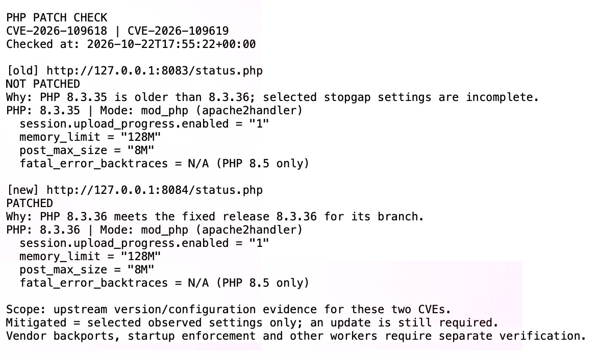
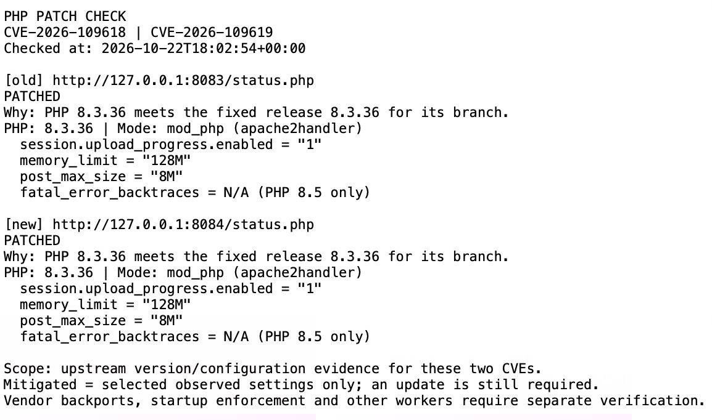

# PHP Patch Check

A defensive portfolio project that checks PHP release versions and selected settings, upgrades a local Apache/PHP container, and records the result. It covers **CVE-2026-109618** and **CVE-2026-109619**, also known as PHP2Shell.

**Verified result:** the `old` service changed from PHP 8.3.35 / **NOT PATCHED** to PHP 8.3.36 / **PATCHED**. Both services now run the fixed release, and the upgraded server still returns `Hello World`.

## What the bugs mean

Imagine PHP preparing information for a web request. If it runs out of memory halfway through, it can jump away before that information is ready. Later, its cleanup code may trust the unfinished information as though the work had completed. That is the core idea behind **CVE-2026-109618**. [OOM advisory](https://github.com/php/php-src/security/advisories/GHSA-w8hw-w9fx-j79w)

**CVE-2026-109619** concerns information left behind between requests. A worker process can retain a reference to memory belonging to a finished request, even after that memory has been released. A subsequent request can use that outdated reference. [Stale-state advisory](https://github.com/php/php-src/security/advisories/GHSA-6wmf-4rv5-p3rp)

These failures can enable remote code execution. This project uses ordinary GET requests and version/configuration evidence; it contains no exploits, attack payloads, or memory-exhaustion tests.

## Local lab

Tested on an Apple silicon Mac with Docker Desktop and Python 3.13.5. Use a local Docker engine. Docker Engine 28 or newer avoids the historical localhost-port exposure issue described in Docker's [port-publishing documentation](https://docs.docker.com/engine/network/port-publishing/).

| Service | Original PHP | Current PHP | Host binding |
| --- | --- | --- | --- |
| `old` | 8.3.35 | 8.3.36 | `127.0.0.1:8083` |
| `new` | 8.3.36 | 8.3.36 | `127.0.0.1:8084` |

Both images use Apache with `mod_php`. The page directory is mounted read-only inside each container. Each container has a 512 MiB memory limit and automatic restarts are disabled. Keep the loopback bindings and run this lab without public proxies or tunnels.

| File | Purpose |
| --- | --- |
| `compose.yaml` | Current configuration: both services patched |
| `compose.before.yaml` | Original comparison: one old release and one fixed release |
| `www/index.php` | Hello World page |
| `www/status.php` | Selected PHP diagnostics returned as JSON |
| `checker.py` | Python checker, using only the standard library |
| `evidence/` | Before/after reports and terminal screenshots |

## How the checker works

The checker requests `/status.php` directly from `127.0.0.1` on ports 8083 and 8084. It bypasses proxy configuration, follows no redirects, uses a five-second socket timeout, and caps diagnostic responses at 16 KiB.

The diagnostic runs through the web server and reports `PHP_VERSION`, `PHP_SAPI`, and four settings: `session.upload_progress.enabled`, `memory_limit`, `post_max_size`, and `fatal_error_backtraces` for PHP 8.5. The checker recognizes `apache2handler` as `mod_php` and `fpm-fcgi` as PHP-FPM.

Versions are compared numerically against the fixed release for their own branch, using PHP's [21 October 2026 announcement](https://www.php.net/archive/2026.php):

| Branch | First fixed release |
| --- | --- |
| 8.2 | 8.2.35 |
| 8.3 | 8.3.36 |
| 8.4 | 8.4.27 |
| 8.5 | 8.5.12 |

| Result | Meaning |
| --- | --- |
| `PATCHED` | The reported upstream release meets the threshold for its branch. |
| `NOT PATCHED` | The release is older and the selected stopgap values do not all match, or it is a legacy branch flagged by default. |
| `NOT PATCHED BUT MITIGATED` | The release is older, but the observed values match this lab's partial stopgap policy. An update is still required. |

The lab policy requires `memory_limit=-1`, disabled session upload progress, a positive POST limit no larger than 8 MiB, and disabled fatal-error backtraces on PHP 8.5. Missing values do not count as disabled settings. This policy assumes a page that needs no uploads.

`ERROR` means the check could not produce a verdict, such as when a server is unreachable, the response is malformed, or a release format/branch is outside the rules. Exit codes are `0` when both servers are patched, `1` when a server is unpatched (including mitigated), and `2` when a check fails. When using `tee` in automation, enable shell `pipefail` to preserve failures from the checker.

## Run the current project

Start Docker Desktop. From the project folder, run:

```bash
docker compose pull
docker compose up -d --pull never
docker compose ps
python3 checker.py
```

Both services should report `PATCHED`. Confirm the application responds:

```bash
curl --noproxy '*' -fsS --max-time 5 http://127.0.0.1:8083/
curl --noproxy '*' -fsS --max-time 5 http://127.0.0.1:8084/
```

Each request should print `Hello World`.

### Reproduce the before/after exercise

This optional exercise intentionally runs the older PHP release on localhost. It is separate from the already verified, patched state. New report names preserve the original evidence.

If `compose.before.yaml` is not present, copy `compose.yaml` to that filename and change only the `old` service's image to `php:8.3.35-apache` in the copy. Keep both port bindings unchanged.

```bash
docker compose -f compose.before.yaml pull
docker compose -f compose.before.yaml up -d --pull never
mkdir -p evidence
python3 checker.py | tee evidence/before-recheck.txt
```

The original configuration should show `old` as `NOT PATCHED` and `new` as `PATCHED`. The current `compose.yaml` already selects PHP 8.3.36 for both services. Apply it to `old`:

```bash
docker compose -f compose.yaml up -d --no-deps --force-recreate --pull never old
docker compose ps
python3 checker.py | tee evidence/after-recheck.txt
curl --noproxy '*' -fsS --max-time 5 http://127.0.0.1:8083/
```

Both services should now report `PATCHED`. Recreating the container starts fresh PHP workers with the selected image; a plain `docker compose restart` does not apply an image change. See Docker's [up](https://docs.docker.com/reference/cli/docker/compose/up/) and [restart](https://docs.docker.com/reference/cli/docker/compose/restart/) documentation.

To stop and remove this project's containers and network while keeping the project files:

```bash
docker compose down
```

## Evidence from the completed run

| Check | Time on 22 October 2026 (EDT) | `old` | `new` |
| --- | --- | --- | --- |
| Before | 13:55:22 | 8.3.35 — NOT PATCHED | 8.3.36 — PATCHED |
| After | 14:02:54 | 8.3.36 — PATCHED | 8.3.36 — PATCHED |

The reports record UTC timestamps; this table shows local time in New Jersey (EDT, UTC−04:00).

Full reports: [before.txt](evidence/before.txt) and [after.txt](evidence/after.txt). The recorded reports show unchanged settings: upload progress `1`, PHP memory limit `128M`, POST limit `8M`, and backtraces not applicable to PHP 8.3. The upgrade changed the runtime version and verdict. An additional GET to the upgraded server returned `Hello World`.

Before: `old` reports **NOT PATCHED** and `new` reports **PATCHED**.



After: both services report **PATCHED**.



The screenshots show the saved reports from this local run. Their versions, verdicts, settings, and timestamps match the accompanying text evidence.

## Temporary settings when an update must wait

The following is reference guidance for an unpatched server. The completed lab uses a fixed release. Configuration changes cover only some known routes through these vulnerabilities.

| Setting | Temporary value | Purpose |
| --- | --- | --- |
| `memory_limit` | `-1`, enforced administratively | Removes PHP's finite per-request memory threshold. |
| `post_max_size` | `8M` without uploads; `32M` when uploads are necessary | Restricts POST data. Keep `upload_max_filesize` smaller. |
| `session.upload_progress.enabled` | `0` | Disables the confirmed early session-processing route. |
| `fatal_error_backtraces` | `0`, PHP 8.5 only | Disables the confirmed fatal-backtrace route. |

Example for Apache server/virtual-host configuration with `mod_php`:

```apache
# Temporary reference settings for a page that needs no uploads.
php_admin_value memory_limit -1
php_admin_value post_max_size 8M
php_admin_value upload_max_filesize 2M
php_admin_flag session.upload_progress.enabled Off

# PHP 8.5 ONLY:
# php_admin_flag fatal_error_backtraces Off
```

Use administrator-controlled startup configuration and restart every PHP worker. Apache's `php_admin_value` and `php_admin_flag` prevent application overrides through `.htaccess` or `ini_set()`; see the [PHP configuration manual](https://www.php.net/manual/en/configuration.changes.php). Session protection must be established before request parsing; `ini_set()` and FPM `.user.ini` are unsuitable for that purpose.

Unlimited PHP memory can increase resource consumption. A container/cgroup memory cap provides an availability boundary, but cannot guarantee that allocation failures are avoided. Do not substitute `RLIMIT_AS` or `RLIMIT_DATA`. Front-end controls should bound decoded body size, fields, parts, headers and nesting, including requests without usable `Content-Length`. [OOM mitigation guidance](https://github.com/php/php-src/security/advisories/GHSA-w8hw-w9fx-j79w)

Also correct invalid or deprecated per-request settings and reachable fatal errors/timeouts. Suppressing diagnostic output does not repair the underlying state. [PHP security announcement](https://www.php.net/archive/2026.php)

These measures do not repair PHP's memory handling. Lower-level allocation failures and other stale-state paths can remain. Upgrade to a fixed release. [Stale-state mitigation guidance](https://github.com/php/php-src/security/advisories/GHSA-6wmf-4rv5-p3rp)

## What this evidence establishes

The live lab demonstrates a version/configuration check, a container upgrade, a fresh report from the web runtime, and a working page afterward. It is not an exploitation test or a complete server security audit.

The checker observes one diagnostic request per service. It cannot establish administrator enforcement, restart status for every worker, front-end limits, package provenance, or coverage of every application route. The mitigated result is deliberately limited to matching selected observed values.

PHP 8.1 and older are flagged by default. Distribution/vendor backports and emergency source backports can exist, so a legacy version string alone cannot establish whether such a patch was applied. Custom version suffixes and future branches require manual review.

Classification tests covered all four fixed-version boundaries, missing/invalid values, PHP 8.5 backtraces, and failed/redirected responses using sample data and mocks. Live validation covered Apache `mod_php`; PHP-FPM mode recognition was checked with sample data, not a running FPM lab.

## What I learned

- I can keep a Docker lab local by binding published ports explicitly to `127.0.0.1`.
- I should inspect the PHP runtime serving web requests when evaluating a web server.
- Version comparisons need numeric components and a separate threshold for each release branch.
- Temporary settings can reduce selected risks while leaving an update necessary.
- Recreating the container and recording before/after results makes a patching exercise verifiable.

## Official sources

Reviewed on 22 October 2026:

1. [PHP.net: security announcement and fixed releases, 21 October 2026](https://www.php.net/archive/2026.php)
2. [PHP GitHub advisory: CVE-2026-109618 — RCE via OOM corruption](https://github.com/php/php-src/security/advisories/GHSA-w8hw-w9fx-j79w)
3. [PHP GitHub advisory: CVE-2026-109619 — RCE via stale global state](https://github.com/php/php-src/security/advisories/GHSA-6wmf-4rv5-p3rp)
